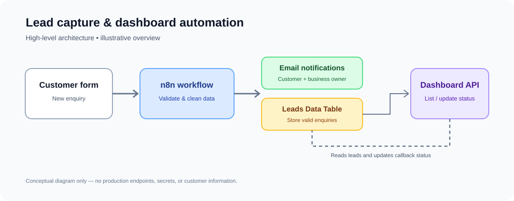

# Tradesperson Lead Capture & Dashboard

A portfolio showcase of an n8n-based lead management automation for trades and service businesses.

> This public overview intentionally excludes original workflow exports, credentials, API keys, webhook identifiers, customer records, and private configuration.

## What it does
- **Lead capture:** receives customer enquiries through a webhook.
- **Input validation:** checks that a name and valid email address are provided.
- **Customer confirmation:** sends an acknowledgement email after a valid submission.
- **Business notifications:** alerts the business owner about new enquiries and highlights urgent requests.
- **Lead storage:** saves valid enquiries to an n8n Data Table.
- **Dashboard API:** returns the lead list for a dashboard interface.
- **Callback tracking:** supports marking a lead as `Called back`.

## Workflow overview

1. A customer submits an enquiry.
2. n8n validates and cleans the submitted fields.
3. Valid enquiries trigger customer and business email notifications.
4. The lead is stored in the `Leads` Data Table.
5. The dashboard API reads leads and can update callback status.

## Technology
- [n8n](https://n8n.io/) — workflow automation
- Gmail integration — email notifications
- n8n Data Tables — lead storage
- Webhooks / JSON API — form and dashboard integration

## Security and privacy
This repository is documentation and illustrative architecture only. It excludes workflow JSON exports, API keys, tokens, OAuth credentials, production webhook URLs, customer contact details, and real lead records. Add screenshots only after sanitizing all identifying information.

A live demo is not linked because no public demo endpoint has been configured.

## Implementation
For implementation files and deployment instructions, use the separate private repository and grant access only to trusted collaborators.
